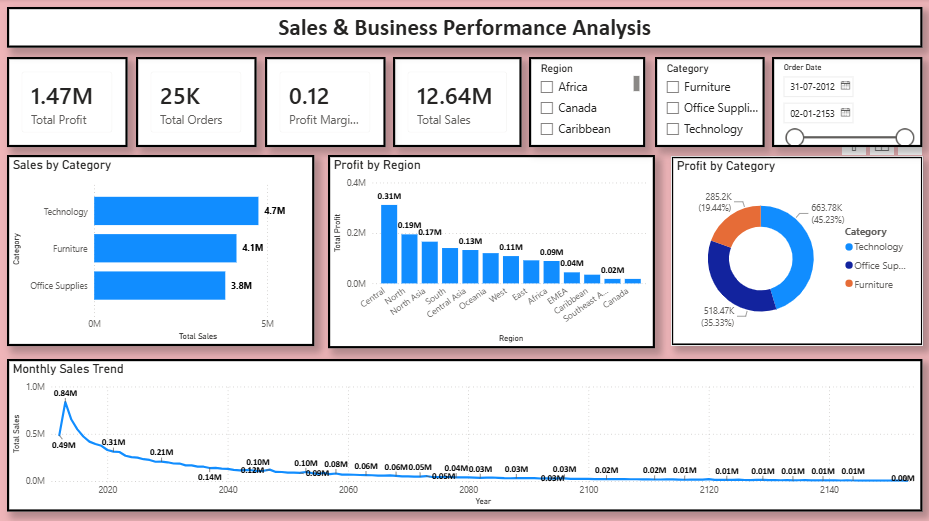

# Sales & Business Performance Analysis

An end-to-end sales analytics project: raw order data prepared in **Excel** and visualised in an interactive **Power BI** dashboard to track profit, sales, orders and margin across categories, regions and time.



## Business Questions

- Which product categories drive the most sales and profit?
- Which regions are the most (and least) profitable?
- How healthy is the overall profit margin?
- Where are discounts and product mix hurting profitability?

## Dataset

Global retail orders dataset (`data/Sales_Business_Performance_1.xlsx`) with **51,290 order lines** and 24 columns (order/ship dates, customer, segment, market, region, product, sales, quantity, discount, profit, shipping cost, order priority).

| Sheet | Description |
|---|---|
| `Orders` | Original raw order data |
| `Orders_Cleaned` | Cleaned table used by the dashboard |
| `Returns` | Returned orders (1,173 records) |
| `People` | Regional managers |

## Dashboard Features

- **KPI cards:** Total Profit, Total Orders, Profit Margin, Total Sales
- **Sales by Category** (bar chart)
- **Profit by Region** (column chart)
- **Profit by Category** (donut chart)
- **Monthly Sales Trend** (line chart)
- **Slicers:** Region, Category, Order Date

## Key Insights

| Metric | Value |
|---|---|
| Total Sales | $12.64M |
| Total Profit | $1.47M |
| Profit Margin | ~11.6% |
| Total Orders | 25,035 |

1. **Technology leads** in both sales ($4.74M) and profit ($0.66M, ~45% of total profit).
2. **Central region is the top profit driver** (~$0.31M), followed by North and North Asia. Canada and Southeast Asia contribute the least.
3. **Tables lose money** (about -$64K) despite $757K in sales, the only loss-making sub-category.
4. **Heavy discounting hurts profit:** orders discounted above 20% are loss-making overall, while undiscounted orders generate the bulk of profit.
5. **Copiers and Phones** are the most profitable sub-categories.

## Tools Used

- **Microsoft Excel**: data preparation and cleaning
- **Power BI Desktop**: data modelling, DAX measures and dashboard design

## Repository Structure

```
sales-business-performance-analysis/
├── README.md
├── .gitignore
├── data/
│   └── Sales_Business_Performance_1.xlsx
├── dashboard/
│   └── Sales_Business_Performance_Analysis_PBI.pbix
└── images/
    └── dashboard_preview.png
```

## How to Use

1. Download or clone this repository.
2. Open `dashboard/Sales_Business_Performance_Analysis_PBI.pbix` in **Power BI Desktop**.
3. If prompted, point the data source to `data/Sales_Business_Performance_1.xlsx` (Home → Transform data → Data source settings).

## Author

**Dipak Patil** | [LinkedIn](https://www.linkedin.com/in/dipak-patil-a69603423/) | [GitHub](https://github.com/dipakAnalytics)
